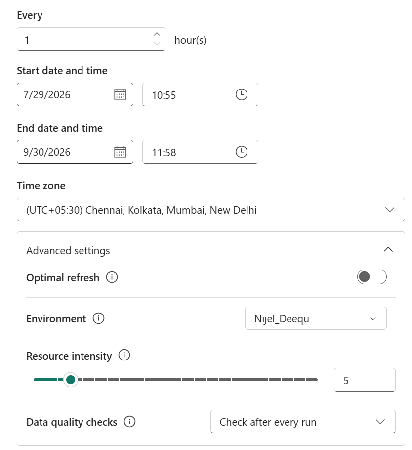
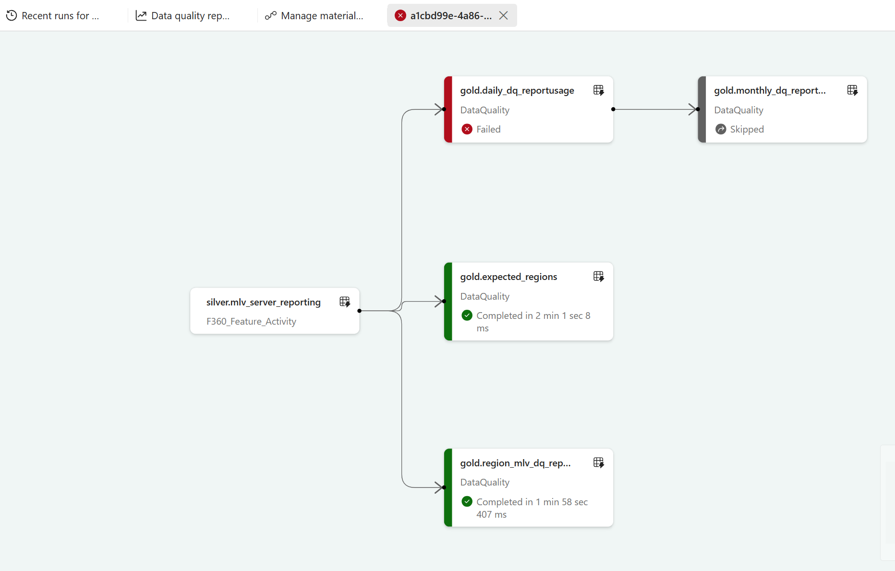
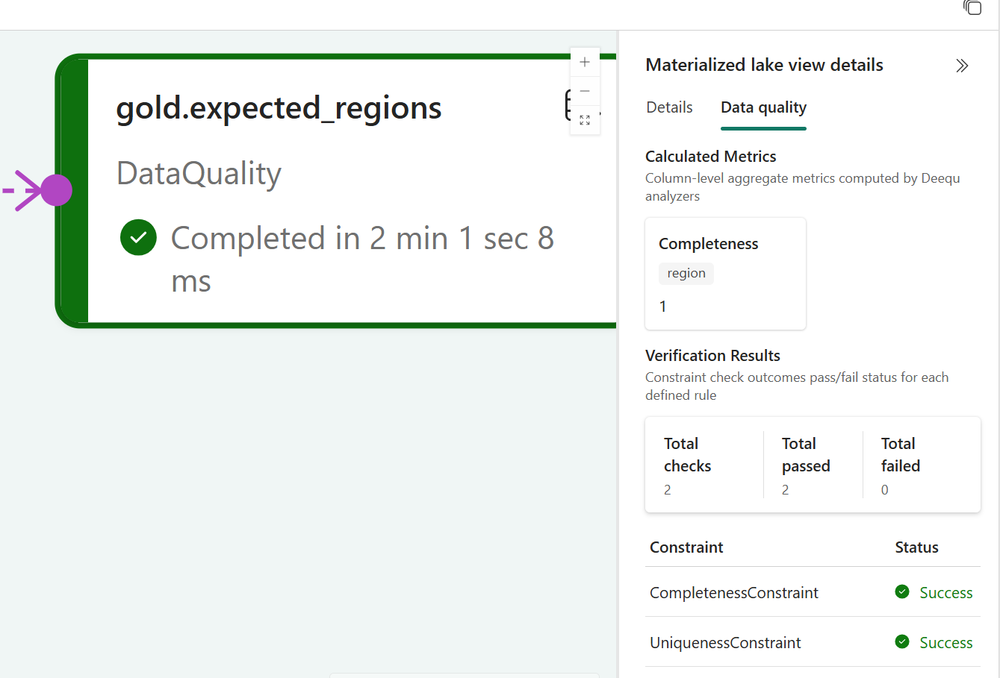

# Data quality in materialized lake views

In medallion architectures, you must enforce data quality at every stage. Poor data quality can lead to incorrect insights and operational inefficiencies.

This article explains how to implement data quality checks in materialized lake views (MLVs) in Microsoft Fabric.

## Implement data quality

Row-level constraints validate each row in isolation (for example, "`customerName` is not null on this row"). Many real quality problems, however, are **properties of a column as a whole**:

- **Uniqueness** — a primary or business key such as `order_id` has no duplicates.
- **Completeness** — a critical column such as `customer_id` doesn't contain nulls.
- **Statistical shape** — the mean, size, or distribution of a column stays within an expected range.

Catching these problems at the point of refresh stops bad data from propagating downstream through your bronze→silver→gold chain, and gives you an auditable quality signal on every run.

- [Row-level data quality constraints](#row-level-data-quality-constraints)
- [Column-level data quality checks](#column-level-data-quality-checks)

### Row-level data quality constraints

In materialized lake views (MLVs) in Fabric, maintain data quality by defining constraints on your views. Without explicit checks, minor data issues can increase processing time or fail the pipeline.

When a row violates a constraint, you can use one of these actions:

- **FAIL**: Stops MLV refresh at the first constraint violation. This is the default behavior, even when you don't specify `FAIL`.

- **DROP**: Continues processing and removes records that violate the constraint. The lineage view shows the count of dropped records.

> [!NOTE]
> If you define both DROP and FAIL actions in an MLV, the FAIL action takes precedence.

#### Define data quality checks in a materialized lake view

When you create a materialized lake view, you can define constraints — data quality rules that validate each row during a refresh. A constraint is a Boolean expression that every row must satisfy. Rows that pass are written to the output table. Rows that fail are handled according to the on-violation setting: they are either dropped silently or cause the entire refresh to fail.

The following example defines the constraint `cust_blank`, which checks if the `customerName` field isn't null. The constraint excludes rows with a null `customerName` from processing.
```sql
CREATE OR REPLACE MATERIALIZED LAKE VIEW IF NOT EXISTS silver.customers_enriched  
(CONSTRAINT cust_blank CHECK (customerName is not null) on MISMATCH DROP)
AS
SELECT
    c.customerID,
    c.customerName,
    c.contact, 
    CASE  
       WHEN COUNT(o.orderID) OVER (PARTITION BY c.customerID) > 0 THEN TRUE  
       ELSE FALSE  
    END AS has_orders 
FROM bronze.customers c LEFT JOIN bronze.orders o 
ON c.customerID = o.customerID;
```

#### System built-in functions

Built-in Spark/SQL functions such as UPPER(), LOWER(), TRIM(), COALESCE(), INITCAP(), and DATE_FORMAT() are fully supported in all MLV contexts for both CREATE and LINEAGE refresh. 


```sql
CREATE MATERIALIZED LAKE VIEW sample_lakehouse.silver.names (
CONSTRAINT substring_check
CHECK (SUBSTRING(name, 1, 2) = 'Al') ON MISMATCH drop
) AS
SELECT id, name
FROM (VALUES (1, 'Alice'), (2, 'Bob'), (3, 'Ann')) AS t(id, name)
```

> [!NOTE]
>System functions are the simplest and most reliable option. They require no registration, work in all contexts and are fully supported during LINEAGE refresh.

#### UDFs – Defined and registered in same notebook

UDFs registered with spark.udf.register() in the same notebook are supported for CREATE in all contexts. For LINEAGE refresh, only PySpark contexts are supported because the UDF definition runs as part of the scheduled notebook execution. 

```python
from pyspark.sql import SparkSession
from pyspark.sql.types import StringType
from pyspark.sql.functions import expr

spark = SparkSession.builder.getOrCreate()

# UDF: Extract domain from email
def extract_email_domain(email):
    if email is None or '@' not in email:
        return None
    return email.split('@')[1]

# Registration
spark.udf.register(
    "udf_email_domain",
    extract_email_domain,
    StringType()
)

@fmlv.materialized_lake_view(
    name="udf_testing_silver.mlv_high_value_customers",
    comment="High-value customers identified by UDF criteria",
    table_properties={"delta.enableChangeDataFeed": "true"}
)
def mlv_high_value_customers():
    return spark.sql("""
        SELECT 
            c.customer_id,
            c.name,
            c.email,
            udf_email_domain(c.email) as email_domain,
            c.segment,
            c.lifetime_value,
            total_transactions.total_amount,
            total_transactions.txn_count
        FROM udf_testing_bronze.customers c
        INNER JOIN (
            SELECT 
                customer_id,
                SUM(amount) as total_amount,
                COUNT(*) as txn_count
            FROM udf_testing_bronze.transactions
            WHERE udf_is_positive(amount)
            GROUP BY customer_id
            HAVING SUM(amount) > 1000
        ) total_transactions ON c.customer_id = total_transactions.customer_id
        WHERE udf_validate_customer(c.email, c.age)
            AND c.segment IN ('premium', 'vip')
    """)

print("✓ Created mlv_high_value_customers")

```
#### Third-party libraries - Pandas UDFs
Third party libraries like Pandas UDFs allow data quality rules to be implemented with vectorized processing. They enable advanced validations such as custom business logic, statistical checks, or pattern detection that are not possible with built-in functions. This helps build scalable and reusable data quality constraints during MLV creation and refresh.

```python
  import fmlv
  from pyspark.sql.types import StructType, StructField, IntegerType, TimestampType, StringType, DoubleType, BooleanType
  from datetime import datetime

  import pandas as pd
  from pyspark.sql.types import BooleanType
  def pandas_check_impl(val):
    # Reject if value < median of [100, 200, 300]
    return val >= pd.Series([100, 200, 300]).median()
  spark.udf.register("pandas_check", pandas_check_impl, BooleanType())

  @fmlv.materialized_lake_view(
    name="silver.pyspark_from_two_sqlmlv_inner_pandas",
    comment="PySpark MLV INNER JOIN using pandas-based constraint and DROP violations"
  )
  @fmlv.check(
    name="dq_pandas_check",
    condition="pandas_check(l3)",
    action="DROP"
  )
  def pyspark_from_two_sqlmlv_inner_pandas():
    # Define the function

    # Register the function as a Spark UDF

    # Read source tables
    df1 = spark.table("silver.base_sqlmlv")
    df2 = spark.table("silver.base_sqlmlv")

    # Rename columns for unique join
    df_left = df1.select([df1[col].alias(f"l{i+1}") for i, col in enumerate(df1.columns)])
    df_right = df2.select([df2[col].alias(f"r{i+1}") for i, col in enumerate(df2.columns)])

    # Perform INNER JOIN
    df = df_left.join(df_right, df_left.l1 == df_right.r1, "inner")
    return df


  df = spark.table("silver.pyspark_from_two_sqlmlv_inner_pandas")
  # All amounts should be >= median (200)
  assert all(df.select("l3").rdd.map(lambda r: r[0] >= 200).collect()), "Unexpected low-value rows found"
  print("PySpark MLV INNER JOIN with pandas-based DQ DROP passed")
```

#### Custom libraries – Python wheel (.whl)

Functions packaged as jar files or wheel files can be installed on the Fabric cluster (via Environment settings) and used in MLV definitions. CREATE and LINEAGE REFRESH is supported for PySpark contexts. See [Manage custom libraries in Fabric environments](../environment-manage-library.md#custom-libraries) for more details.

```python
  %%pyspark
  import fmlv
  from pyspark.sql.types import StructType, StructField, IntegerType, TimestampType, StringType, DoubleType, BooleanType
  from datetime import datetime

  from pyspark.sql.types import BooleanType
  from custom_dq_lib import threshold_check
  def custom_check_impl(val):
    return threshold_check(val, threshold=200)
  spark.udf.register("custom_check", custom_check_impl, BooleanType())

  @fmlv.materialized_lake_view(
    name="silver.pyspark_from_two_sqlmlv_inner_custom_whl",
    comment="PySpark MLV INNER JOIN using custom DQ library and DROP violations",
    replace=True
  )
  @fmlv.check(
    name="dq_custom_check",
    condition="custom_check(l3)",
    action="DROP"
  )
  def pyspark_from_two_sqlmlv_inner_custom():
    # Wrap the custom function as Spark UDF


    # Read source tables
    df1 = spark.table("silver.base_sqlmlv")
    df2 = spark.table("silver.base_sqlmlv")

    # Rename columns for unique join
    df_left = df1.select([df1[col].alias(f"l{i+1}") for i, col in enumerate(df1.columns)])
    df_right = df2.select([df2[col].alias(f"r{i+1}") for i, col in enumerate(df2.columns)])

    # Perform INNER JOIN
    df = df_left.join(df_right, df_left.l1 == df_right.r1, "inner")
    return df


    df = spark.table("silver.pyspark_from_two_sqlmlv_inner_custom_whl")
    # All amounts should be >= threshold (200)
    assert all(df.select("l3").rdd.map(lambda r: r[0] >= 200).collect()), "Unexpected low-value rows found"
    print("PySpark MLV INNER JOIN with custom DQ library passed")

```

#### Fabric User Data Functions

Fabric User Data Functions (UDFs) are centrally defined and managed in the Fabric workspace. They're available to any notebook or pipeline without needing to be re-registered per session, making them ideal for production MLV pipelines. This feature is supported only in PySpark contexts for both CREATE and LINEAGE refresh. Learn more about User Data Functions here. For more information, see [Fabric User Data Functions overview](../user-data-functions/user-data-functions-overview.md).

```python
  %%pyspark
  import fmlv
  from pyspark.sql import functions as F
  from notebookutils import udf

  myFuncs = udf.getFunctions("UserDataFunction_1")

  def add_greeting_column(df):
    pdf = df.toPandas()
    pdf["greeting"] = pdf["name"].apply(lambda n: myFuncs.hello_fabric(n))
    return spark.createDataFrame(pdf)
```

```python
  import fmlv
  from pyspark.sql.types import StructType, StructField, IntegerType, StringType, DoubleType

  # -------------------------------------------------------------
  # Define base PySpark MLV (no SQL)
  # -------------------------------------------------------------
  @fmlv.materialized_lake_view(
    name="silver.base_pysparkmlv",
    comment="Base MLV created using PySpark",
    replace=True
  )
  def base_pysparkmlv():

    schema = StructType([
        StructField("id", IntegerType(), True),
        StructField("name", StringType(), True),
        StructField("amount", DoubleType(), True),
        StructField("country", StringType(), True)
    ])

    data = [
        (1, "Alice", 100.0, "US"),
        (2, "Bob", 200.0, "UK"),
        (3, "Charlie", 300.0, "UK")
    ]

    return spark.createDataFrame(data, schema)

```

```python
  @fmlv.materialized_lake_view(
    name="silver.mlv_udfn_null_test",
    replace=False
  )
  @fmlv.check(
    name="null_check",
    condition="greeting IS NOT NULL",
    action="FAIL"
  )
  def mlv_udfn_null_test():
    df = spark.table("silver.base_pysparkmlv")
    return add_greeting_column(df)
```

### Column-level data quality checks

#### How it works

Define column-level data quality (DQ) checks with three Python decorators that you place in a notebook cell, **separate from the MLV definition**:

| Decorator | Purpose |
|----|----|
| `@fmlv.dq_suite(mlv_name=…)` | Registers a data quality suite against a named, existing MLV and loads its data for the checks to run on. |
| `@fmlv.validate("<fn>", "FAIL"\|"WARN")` | Runs a validation check with a pass/fail outcome and a chosen action (see *Control the outcome* below). |
| `@fmlv.analyze("<fn>")` | Runs a profiling pass that computes column metrics (size, completeness, mean, …). Produces metrics only — it never fails the run. |

Because the suite targets an MLV by name, data quality can be owned, run, and scheduled independently of the MLV definition — and you can run checks without triggering a refresh.

#### Step 1: Set up the runtime

Configure the dependencies for your Fabric runtime version before defining column-level data quality checks.

##### Fabric runtimes earlier than 2.0

Download the [PyDeequ 1.7.0 wheel](https://files.pythonhosted.org/packages/59/91/742862cd683e17de293c2ce4b5cd433b555de15181be37d7e9fb9889243c/pydeequ-1.7.0-py3-none-any.whl) and upload it as a custom library in your Fabric environment. For instructions, see [Upload custom libraries](../environment-manage-library.md#custom-libraries).

##### Fabric runtime 2.0 or later

Add the following Spark properties:

| Spark property | Value |
|---|---|
| `spark.driver.extraClassPath` | `/opt/deequ/jars/*` |
| `spark.executor.extraClassPath` | `/opt/deequ/jars/*` |

You can add these properties in either an environment or a notebook:

- **Environment:** Add the properties under **Spark Compute** > **Spark properties**, then save and publish the environment. For instructions, see [Add Spark configurations to a custom environment](../migrate-synapse-spark-configurations.md#option-1-adding-spark-configurations-to-custom-environment).
- **Notebook:** Add the properties in the `conf` object of a `%%configure` command in the first code cell, before starting the Spark session. For instructions, see [Spark session configuration magic command](../author-execute-notebook.md#spark-session-configuration-magic-command).

#### Step 2: Define column-level checks

In this example, define column-level data quality checks for the `sales_db.daily_orders` materialized lake view, specified by `mlv_name` in `@fmlv.dq_suite`.

Put the suite registration and its entry functions in a single data quality cell. The following example runs **two checks** in one validation pass — `customer_id` must be complete (no nulls) and `order_id` must be unique:

```python
# Data quality cell — separate from the MLV definition
@fmlv.dq_suite(mlv_name="sales_db.daily_orders", replace=True)
@fmlv.validate("completeness_and_uniqueness", "FAIL")
def daily_orders_dq():
    pass

# Entry function — returns a PyDeequ VerificationResult DataFrame
def completeness_and_uniqueness(df):
    from pydeequ.checks import Check, CheckLevel
    from pydeequ.verification import VerificationSuite, VerificationResult

    check = Check(spark, CheckLevel.Error, "Completeness & Uniqueness")
    result = (
        VerificationSuite(spark)
        .onData(df)
        .addCheck(
            check.isComplete("customer_id")   # check 1: no nulls
                 .isUnique("order_id")        # check 2: no duplicates
        )
        .run()
    )
    return VerificationResult.checkResultsAsDataFrame(spark, result)
```

**Add metrics without failing the run.** Stack an `@fmlv.analyze` pass to compute column metrics (size, completeness, mean, …) for observability. Analyze results are always recorded and never block a run — useful while validation rules are still evolving.

```python
@fmlv.dq_suite(mlv_name="sales_db.daily_orders", replace=True)
@fmlv.validate("completeness_and_uniqueness", "FAIL")
@fmlv.analyze("column_profiling")
def daily_orders_dq():
    pass

def column_profiling(df):
    from pydeequ.analyzers import AnalysisRunner, AnalyzerContext, Size, Completeness, Mean
    result = (
        AnalysisRunner(spark)
        .onData(df)
        .addAnalyzer(Size())
        .addAnalyzer(Completeness("customer_id"))
        .addAnalyzer(Mean("amount"))
        .run()
    )
    return AnalyzerContext.successMetricsAsDataFrame(spark, result)
```

##### Control the outcome: FAIL vs. WARN

The action on `@fmlv.validate` decides what happens when a check fails:

- **`FAIL`** — the check failure fails the data quality run and **blocks the downstream MLVs that depend on it**. Use it for hard contracts such as primary keys and mandatory fields.
- **`WARN`** — the failure is logged but the run still succeeds and downstream MLVs are *not* blocked. Use it for soft or advisory rules.

#### Step 3: Enable data quality checks in a schedule

Choose whether column-level checks run as part of a refresh schedule. In the **Advanced settings** of the **Create new schedule** experience, the **Data quality checks** dropdown offers two options:

- **Check after every run** — the data quality suite runs automatically after each MLV refresh in that schedule completes.
- **No checks** — data quality is skipped for that schedule; the MLV still refreshes on its cadence.



The **Data quality checks** setting in a schedule's **Advanced settings** — choose *Check after every run* or *No checks*.

##### How a failed check affects the pipeline

In the lineage view, the data quality check on `gold.daily_dq_reportusage` was defined with `FAIL` and failed. As a result its downstream dependent, `gold.monthly_dq_report…`, is automatically **Skipped**, while independent branches (`gold.expected_regions`, `gold.region_mlv_dq_rep…`) complete normally.



A `FAIL` data quality check stops the chain — the failed node's downstream dependent is skipped, but independent branches continue.

**Execution order.** When a suite has both types, all `@fmlv.validate` functions run first (in definition order), then all `@fmlv.analyze` functions. A failing check is recorded and execution continues; the overall outcome is decided after all checks complete — the run fails only if a `FAIL`-action check failed.

#### Step 4: View and analyze the data quality report

The run history reflects whether data quality was on or off for each execution. You can also run a suite on demand from its notebook at any time, independent of any refresh.

Select any MLV node in the lineage view and open the **Data quality** tab of the details pane to see that run's results:

- **Calculated Metrics** — the column-level aggregate metrics computed by the Deequ analyzers (for example, `Completeness` of `region`).
- **Verification Results** — a summary of *total checks*, *total passed*, and *total failed*, followed by each constraint and its pass/fail **Status**, so you can see exactly which rule passed or failed.



The **Data quality** tab shows calculated metrics and per-constraint verification results for the selected MLV run.

The MLV run history also shows a data quality status for each run — **Success**, **Failed**, or no indicator when no suite ran — so you can spot problem runs at a glance without opening each node.

#### Supported checks and analyzers

Because column-level DQ is powered by [Amazon Deequ](https://github.com/awslabs/deequ), you can use the full Deequ library inside your entry functions. **Validation checks** (used with `@fmlv.validate`) are `Check` constraints that produce a pass/fail outcome; **analyzers** (used with `@fmlv.analyze`) compute a metric with no pass/fail. The most common ones are listed in the following tables.

##### Validation checks — `@fmlv.validate`

| Check | Description | Example |
|----|----|----|
| `hasSize` | The row count of the view satisfies a condition. | `.hasSize(lambda s: s == 5)` |
| `isComplete` | The column contains no null values. | `.isComplete("customer_id")` |
| `hasCompleteness` | The fraction of non-null values meets a threshold. | `.hasCompleteness("email", lambda c: c >= 0.9)` |
| `isUnique` | The column has no duplicate values. | `.isUnique("order_id")` |
| `hasUniqueness` | The fraction of unique values meets a condition. | `.hasUniqueness(["brand"], lambda u: u == 1.0)` |
| `hasDistinctness` | The fraction of distinct values meets a condition. | `.hasDistinctness(["title"], lambda d: d > 0.5)` |
| `isPrimaryKey` | The column (or set of columns) uniquely identifies each row. | `.isPrimaryKey("order_id")` |
| `isContainedIn` | All values fall within an allowed set. | `.isContainedIn("priority", ["high", "low"])` |
| `isNonNegative` / `isPositive` | The column contains no negative / only strictly positive values. | `.isNonNegative("num_views")` |
| `isLessThan` / `isGreaterThan` | One column is consistently less / greater than another. | `.isLessThan("discount", "price")` |
| `hasMin` / `hasMax` | The column minimum / maximum meets a condition. | `.hasMax("age", lambda v: v <= 120)` |
| `hasMean` / `hasSum` | The column mean / sum meets a condition. | `.hasSum("total_votes", lambda v: v > 0)` |
| `hasStandardDeviation` | The column standard deviation meets a condition. | `.hasStandardDeviation("amount", lambda v: v < 5)` |
| `hasApproxQuantile` | An approximate quantile (for example, median) meets a condition. | `.hasApproxQuantile("num_views", 0.5, lambda v: v <= 10)` |
| `hasCorrelation` | The Pearson correlation between two columns meets a condition. | `.hasCorrelation("a", "b", lambda c: c > 0.8)` |
| `hasNumberOfDistinctValues` | The count of distinct values meets a condition. | `.hasNumberOfDistinctValues("locale", lambda n: n == 5)` |
| `hasEntropy` | The information content (entropy) of the column meets a condition. | `.hasEntropy("locale", lambda e: e > 2.0)` |
| `hasDataType` | Values conform to an expected data type. | `.hasDataType("id", ConstrainableDataTypes.Integral)` |
| `hasPattern` / `containsURL` / `containsEmail` | The fraction of values matching a regex / URL / email pattern meets a condition. | `.containsURL("description", lambda c: c >= 0.5)` |
| `containsCreditCardNumber` / `containsSocialSecurityNumber` | The fraction of values matching a credit-card / SSN pattern meets a condition. | `.containsCreditCardNumber("notes", lambda c: c == 0)` |
| `satisfies` | The fraction of rows satisfying a custom SQL predicate meets a condition. | `.satisfies("age >= 18", "adults", lambda c: c == 1.0)` |

##### Analyzers / metrics — `@fmlv.analyze`

| Metric | Description | Example |
|----|----|----|
| `ApproxCountDistinct` | Approximate number of distinct values, computed with HyperLogLog++ sketches. | `ApproxCountDistinct("product_id")` |
| `ApproxQuantile` | Approximate quantile of a distribution. | `ApproxQuantile("locale_encoded", 0.5)` |
| `ApproxQuantiles` | Several approximate quantiles of a distribution. | `ApproxQuantiles("locale_encoded", [0.1, 0.5, 0.9])` |
| `Completeness` | Fraction of non-null values in a column. | `Completeness("product_id")` |
| `Compliance` | Fraction of rows that comply with a given column constraint. | `Compliance("locale", "locale in ('es','jp','us')")` |
| `Correlation` | Pearson correlation between two columns, in the range \[-1, 1\]. | `Correlation("title", "brand")` |
| `CountDistinct` | Number of distinct values. | `CountDistinct("locale")` |
| `DataType` | Distribution of data types (Boolean, Fractional, Integral, String). | `DataType("locale")` |
| `Distinctness` | Fraction of distinct values over the total number of values. | `Distinctness("title")` |
| `Entropy` | Information content of a column's value distribution, measured in nats. | `Entropy("locale_encoded")` |
| `Maximum` / `Minimum` | Maximum / minimum value of a column. | `Maximum("locale_encoded")` |
| `Mean` | Mean value; null values are excluded. | `Mean("locale_encoded")` |
| `MutualInformation` | How much information about one column can be inferred from another; symmetric and nonnegative. | `MutualInformation(["title", "brand"])` |
| `PatternMatch` | Fraction of rows that comply with a given regular expression. | `PatternMatch("locale", r"\w{2}")` |
| `Size` | Number of rows in the DataFrame. | `Size()` |
| `Sum` | Sum of all values of a column. | `Sum("total_votes")` |
| `UniqueValueRatio` | Fraction of unique values over the number of all distinct values. | `UniqueValueRatio(["brand"])` |
| `Uniqueness` | Fraction of unique values over the number of all values. | `Uniqueness(["brand"])` |

The open-source **Amazon Deequ** library provides these checks and analyzers. For the complete and authoritative list, see the Deequ project at [github.com/awslabs/deequ](https://github.com/awslabs/deequ/blob/master).

#### Summary

1. **Create your MLV** and note its fully qualified name.
1. **In a separate data quality cell,** register a suite with `@fmlv.dq_suite(mlv_name=…)`.
1. **Add checks** — stack `@fmlv.validate("<fn>", "FAIL"|"WARN")` and/or `@fmlv.analyze("<fn>")` and write the matching entry functions returning PyDeequ DataFrames.
1. **Run it** — on demand from the notebook, or turn the data quality toggle on when creating a schedule.
1. **Review results** in the lineage **Data quality** tab and the run history.

#### Related content

- [Data quality in Materialized Lake Views — Microsoft Learn](./data-quality.md)
- [Materialized Lake Views overview — Microsoft Learn](./overview-materialized-lake-view.md)
- [DeeQu documentation](https://github.com/awslabs/deequ)

## Related content

- [Refresh materialized lake views](./refresh-materialized-lake-view.md)
- [Power BI reports for data quality](./data-quality-reports.md)
