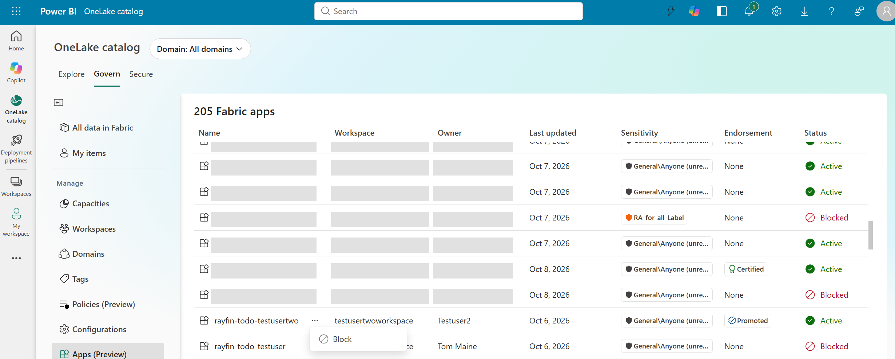
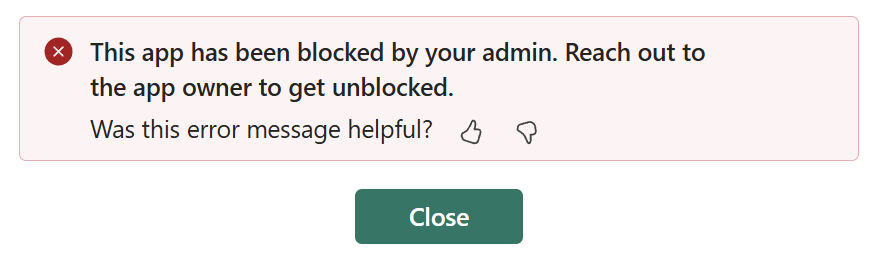
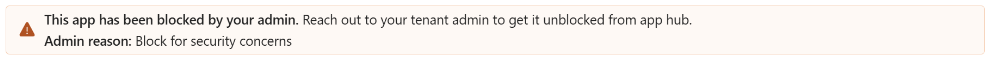

# Block and unblock Fabric apps (preview)

Use the **Apps** view on the OneLake catalog's **Govern** tab to review Fabric apps across your tenant and temporarily block users from loading an app when you identify a potential concern.

Blocking an app prevents users from loading it while allowing the app owner to continue accessing the app to investigate the issue, make changes, and test fixes. An authorized administrator must unblock the app before other users can load it again.

[!INCLUDE [Fabric feature-preview-note](../includes/feature-preview-note.md)]

## Prerequisites

To use the **Apps** view, you must be a [Fabric administrator](../admin/roles.md).

## View Fabric apps in your tenant

To review Fabric apps across your tenant:

1. Sign in to Fabric by using your administrator account.
1. Select **OneLake catalog**, and then select the **Govern** tab.
1. Select **Apps (Preview)**.
1. Review the list of Fabric apps.

The **Apps** view shows each app's name, workspace, owner, last updated date, sensitivity, endorsement, and status. The status indicates whether an app is **Active** or **Blocked**.

## Block a Fabric app

Block an app when you need to prevent users from loading it while the app owner investigates or resolves a concern.

1. In the **Apps** view, find the active app that you want to block.
1. Select the options menu (three dots) next to the app's name.
1. Select **Block**.

   

1. In **Reason (Optional)**, enter a reason for blocking the app, if needed.
1. Select **Block** to confirm.

To leave the app unchanged, select **Cancel** instead.

When the operation succeeds, the app's status changes to **Blocked**, and the options menu provides the option to unblock it. If the operation fails, an error appears and the app's status remains unchanged.

### What happens when an app is blocked

When you block an app, the following restrictions and owner capabilities apply:

- Users other than the app owner, including anonymous users, can't load the app, even from a direct link.
- The app owner can still load the app to investigate the concern and test fixes.
- The app owner can continue publishing changes, but publishing doesn't unblock the app or change the block information.
- The block remains in effect until an authorized Fabric administrator unblocks the app.

Users who try to load a blocked app see the following message:

The app owner sees a blocked-app notice on the app's management page. If the administrator provided a reason, the notice includes it.

## Unblock a Fabric app

Unblock an app after the concern is resolved and users can safely access the app again.

1. In the **Apps** view, find the blocked app that you want to unblock.
1. Select the options menu (three dots) next to the app's name.
1. Select **Unblock**.
1. Confirm that you want to unblock the app.

When the operation succeeds, the app's status changes to **Active**, and the options menu provides the option to block it. The app's management page no longer shows the blocked-app notice or its associated reason. If the operation fails, an error appears and the app's status remains unchanged.

Unblocking restores the ability to load the app according to its existing permissions. It doesn't grant access to users who didn't already have permission to use the app.

## Considerations and limitations

Blocking restricts app loading; it isn't a full shutdown of the app.

Blocking an app:

- Doesn't delete the app.
- Doesn't change the app's owner.
- Doesn't change sharing or access permissions.
- Doesn't automatically end sessions that are already open.
- Doesn't stop background execution.
- Doesn't independently restrict access to the app's backend resources or APIs.

## Related content

- [What is Fabric Apps (Preview)?](../apps/overview.md)
- [OneLake catalog overview](onelake-catalog-overview.md)
